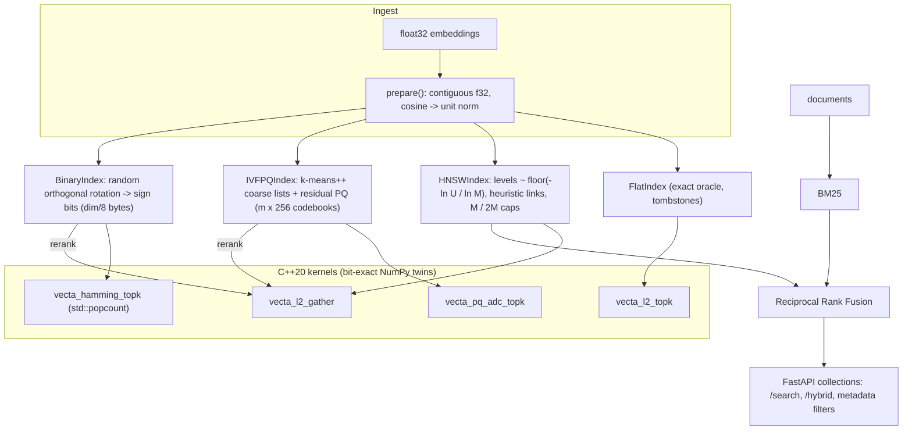

# Vecta — Vector Search Engine (HNSW · IVF-PQ · 1-bit RaBitQ-style codes · Hybrid BM25+RRF)

[](https://github.com/nagarjunak-pixel/vecta/actions/workflows/ci.yml)
    

**Vecta is a from-scratch retrieval engine for RAG and semantic search. It covers the three main approximate-nearest-neighbour families and a hybrid retriever:**

- **Graph search:** HNSW with the paper's neighbour-selection heuristic, filtered search and tombstone deletes, plus save/load.
- **Compressed inverted file:** IVF-PQ with residual product quantization, asymmetric distance (ADC) tables and exact re-ranking.
- **1-bit codes:** a RaBitQ-style random orthogonal rotation, sign bits and a hardware-popcount Hamming shortlist, followed by exact re-ranking.
- **Hybrid retrieval:** Okapi BM25 fused with dense results by Reciprocal Rank Fusion.

The hot loops run in **native C++20 kernels that are bit-exact with their NumPy twins**: both accumulate in float64, both use `(distance, id)` ordering, and the C++ build sets `-ffp-contract=off`.
Everything is measured against an exact brute-force oracle with ANN-Benchmarks-style recall@10.

```text
                       Vecta ANN sweep: gauss-64c-96d-20000 (200 queries, k=10)
┏━━━━━━━━━━━━━━━┳━━━━━━━━━━━━━━━━━━━━━━━━━━━━━━━━━━━━━┳━━━━━━━━━━━┳━━━━━━━┳━━━━━━━━━━━┳━━━━━━━━━━━━━━━┓
┃ index         ┃ params                              ┃ recall@10 ┃   QPS ┃ bytes/vec ┃ exact dists/q ┃
┡━━━━━━━━━━━━━━━╇━━━━━━━━━━━━━━━━━━━━━━━━━━━━━━━━━━━━━╇━━━━━━━━━━━╇━━━━━━━╇━━━━━━━━━━━╇━━━━━━━━━━━━━━━┩
│ flat          │ exact                               │     1.000 │  1831 │       384 │         20000 │
│ hnsw          │ M=16,ef=16                          │     0.983 │  4826 │       512 │           212 │
│ hnsw          │ M=16,ef=32                          │     0.999 │  1763 │       512 │           281 │
│ hnsw          │ M=16,ef=64                          │     1.000 │  1695 │       512 │           368 │
│ hnsw          │ M=16,ef=128                         │     1.000 │  1146 │       512 │           473 │
│ ivf-pq        │ nlist=141,m=16,nprobe=4,rerank=0    │     0.550 │  2952 │        16 │             0 │
│ ivf-pq        │ nlist=141,m=16,nprobe=16,rerank=0   │     0.550 │   748 │        16 │             0 │
│ ivf-pq        │ nlist=141,m=16,nprobe=8,rerank=50   │     0.968 │  1388 │        16 │            50 │
│ ivf-pq        │ nlist=141,m=16,nprobe=16,rerank=100 │     0.999 │   660 │        16 │           100 │
│ binary+rerank │ bits=96,rerank=50                   │     0.665 │ 14905 │        16 │            50 │
│ binary+rerank │ bits=96,rerank=200                  │     0.951 │  8715 │        16 │           200 │
│ binary+rerank │ bits=96,rerank=500                  │     0.991 │  5090 │        16 │           500 │
└───────────────┴─────────────────────────────────────┴───────────┴───────┴───────────┴───────────────┘
           Native kernels (c++20-native (clang++ -O3)) vs NumPy twins
┏━━━━━━━━━━━━━━━━━━━━━━━━━━━━━━━━━━┳━━━━━━━━━━━┳━━━━━━━━━━┳━━━━━━━━━┳━━━━━━━━━━━┓
┃ kernel                           ┃ native ms ┃ numpy ms ┃ speedup ┃ bit-exact ┃
┡━━━━━━━━━━━━━━━━━━━━━━━━━━━━━━━━━━╇━━━━━━━━━━━╇━━━━━━━━━━╇━━━━━━━━━╇━━━━━━━━━━━┩
│ exact L2 top-k (20 queries)      │ 10.81     │ 84.38    │ 7.8x    │ True      │
│ PQ ADC scan (m=16)               │ 0.14      │ 1.53     │ 11.2x   │ True      │
│ Hamming popcount top-k (128-bit) │ 0.06      │ 1.27     │ 20.8x   │ True      │
└──────────────────────────────────┴───────────┴──────────┴─────────┴───────────┘
HNSW graph: 20000 nodes, max level 4, mean L0 degree 13.5, reachable 1.000; filtered (even ids) recall@10 = 1.000
```

The full report is in [`benchmarks/results.json`](benchmarks/results.json), and CI regenerates it on every push.

**How to read it:**
- HNSW reaches **0.999 recall@10 while computing exact distances to only 281 of 20,000 vectors (1.4%)**.
- IVF-PQ stores **16 bytes per vector instead of 384 (24× smaller)**. Without re-ranking, PQ quantisation error caps recall at 0.55 no matter how many lists are probed. Re-ranking just 100 candidates exactly lifts it to 0.999.
- 1-bit codes with a 500-candidate re-rank reach 0.991.

QPS figures are single-threaded and from a Python driver, so treat them as relative. *Exact distances per query* is the hardware-independent cost metric.

---

## Architecture



| Module | Highlights |
| --- | --- |
| [`csrc/vecta_kernels.cpp`](csrc/vecta_kernels.cpp) | Exact L2 top-k with an alive mask, gathered L2 for graph expansion, PQ ADC scan, and Hamming top-k via `std::popcount`. Every top-k uses a `(distance, id)` max-heap with `-1`/`+inf` padding. |
| [`kernels.py`](src/vecta/kernels.py) | Compiles the kernels with a cache keyed on SHA-256 of source and flags, and loads them via `ctypes`. NumPy twins replicate the C++ accumulation order exactly. |
| [`graph.py`](src/vecta/graph.py) | `HNSWIndex`: Malkov & Yashunin (2018), including Algorithm 4's heuristic, which keeps the long-range links between clusters. Filtered and deleted nodes are still traversed but never returned, so filters don't break connectivity. `.npz` persistence. Also `BinaryIndex`. |
| [`quantize.py`](src/vecta/quantize.py) | `FlatIndex`, k-means++ with Lloyd iterations (empty clusters reseeded), `ProductQuantizer` (Jégou et al., 2011) and `IVFPQIndex` (residual encoding, `nprobe`, exact re-ranking). |
| [`hybrid.py`](src/vecta/hybrid.py) | BM25 with Lucene's non-negative IDF, and RRF (Cormack et al., 2009). |
| [`api.py`](src/vecta/api.py) | Named collections (HNSW or flat): add, search with metadata-equality filters, delete, and hybrid search. |
| [`bench.py`](src/vecta/bench.py) / [`cli.py`](src/vecta/cli.py) | Reproducible sweep and kernel benchmark (`vecta bench`), plus `vecta serve`. |

## Quick start

```bash
uv sync --python 3.13 --all-extras
uv run vecta bench --output benchmarks/results.json   # ~35 s on a laptop
uv run vecta serve --port 8095                        # http://127.0.0.1:8095/docs
```

```python
import numpy as np
from vecta import HNSWIndex, IVFPQIndex, clustered_gaussians, recall_at_k, FlatIndex

ds = clustered_gaussians(n=20_000, nq=100, dim=96)
truth = FlatIndex(96); truth.add(ds.base)
gt, _ = truth.search(ds.queries, 10)

hnsw = HNSWIndex(96, m=16, ef_construction=100, metric="l2")
hnsw.add(ds.base)
ids, dists = hnsw.search(ds.queries, k=10, ef=32)
print(recall_at_k(ids, gt, 10))                       # ~0.999
ids, _ = hnsw.search(ds.queries, k=10, filter_fn=lambda i: i % 2 == 0)   # filtered search

ivf = IVFPQIndex(96, nlist=128, m=16).train(ds.base)
ivf.add(ds.base)
ids, _ = ivf.search(ds.queries, k=10, nprobe=16, rerank=100)            # 16 B/vector codes
```

```bash
# Hybrid retrieval over HTTP
curl -X POST localhost:8095/v1/collections -H 'content-type: application/json' \
     -d '{"name":"docs","dim":3,"index":"hnsw","metric":"cosine"}'
curl -X POST localhost:8095/v1/collections/docs/points -H 'content-type: application/json' \
     -d '{"vectors":[[1,0,0],[0,1,0]],"texts":["hnsw graph","bm25 lexical"],"metadata":[{"lang":"en"},{"lang":"de"}]}'
curl -X POST localhost:8095/v1/collections/docs/hybrid -H 'content-type: application/json' \
     -d '{"vector":[0.9,0.1,0],"text":"lexical","k":2}'
```

## Engineering guarantees

- **Oracle-checked.** HNSW, IVF-PQ and binary recall are measured against the exact flat index. Kernel results are checked against brute-force NumPy, and ADC tables against decoded-vector distances.
- **Bit-exact native ↔ NumPy.** Hypothesis property tests use duplicated vectors and tiny code alphabets to force distance ties, and the two paths still agree to the last bit.
- **Graph invariants are tested:** degree caps (`2M` on layer 0, `M` above), no self-loops, full reachability from the entry point, filtered results only, deleted ids never returned, and identical results after save/load.
- **Gates:** ruff, `mypy --strict` on src and tests, pytest with **≥95% branch coverage** (currently 99%+), C++ built with `-Wall -Wextra -Werror` in CI, and **no mocks**.

## Scope and honest limits

- Graph construction is single-threaded Python, with distances in C++. 20k × 96d builds in about 26 s. A production build would move the insert loop into C++ and parallelise it.
- The dataset is a synthetic clustered Gaussian mixture with a power-law spectrum, so CI is deterministic and needs no download. The API takes any float32 embeddings.
- Deletes are tombstones; there is no compaction or graph repair yet.

## References

Malkov & Yashunin, *HNSW* (TPAMI 2018) · Jégou, Douze & Schmid, *Product Quantization for NN Search* (TPAMI 2011) · Gao & Long, *RaBitQ* (SIGMOD 2024) · Arthur & Vassilvitskii, *k-means++* (2007) · Robertson & Zaragoza, *BM25* (2009) · Cormack, Clarke & Büttcher, *RRF* (SIGIR 2009) · Aumüller et al., *ANN-Benchmarks* (2020).

---

## Author & Canonical Portfolio

Engineered by **Nagarjuna Reddy Kamireddy** (*Lead AI Architect*). Released under the [Apache-2.0 License](LICENSE).
- **Architecture Portfolio & Case Studies:** [https://nagarjunak-pixel.github.io/](https://nagarjunak-pixel.github.io/)
- **GitHub:** [@nagarjunak-pixel](https://github.com/nagarjunak-pixel) · **LinkedIn:** [in/nagarjuna-kamireddy](https://linkedin.com/in/nagarjuna-kamireddy)
